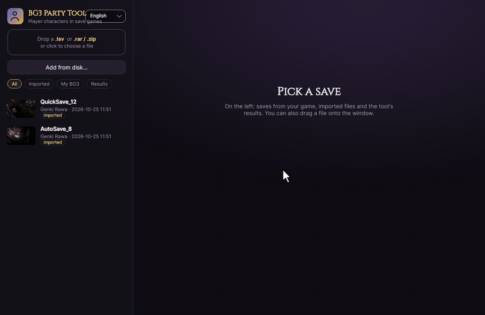

# BG3 Party Tool

*[English](README.md) · Polski*

Odkłada postać gracza w save'ie Baldur's Gate 3 tak, żeby nowa osoba dołączająca do kampanii w trybie współpracy
dostała **kreator postaci**, a nie cudzą postać, i przywraca odłożoną postać później.

Gra sama tego nie umie: postać odesłana do szafy Marnieja nadal jest postacią gracza i dostaje ją następna osoba, która
dołączy. Narzędzie edytuje więc save. Oryginalny save nigdy nie jest zmieniany; każda operacja tworzy nowy.



## Pobieranie

Najnowsza wersja jest w [Releases](https://github.com/nirnx/bg3-party-tool/releases): `BG3PartyTool-win-x64.zip`
(Windows) albo `BG3PartyTool-linux-x64.tar.gz` (Linux). Jeden plik, bez instalacji.

## Jak używać

1. Uruchom narzędzie. Po lewej są Twoje save'y z BG3 (folder gry znajduje się sam na Windowsie i Linuksie, także dla
   natywnej wersji linuksowej, Protona i prefiksów Heroic/Wine). Możesz też upuścić na okno `.lsv` albo `.rar`/`.zip`
   z save'ami, albo użyć **Dodaj z dysku…**.
2. Wybierz save i kliknij **Odłóż postać** przy graczu, który odchodzi. Nowy save trafia prosto do Twoich save'ów BG3
   (albo do folderu narzędzia, jeśli hostuje ktoś inny i trzeba mu go wysłać). Dane postaci lądują w
   `<Imię>.postac.json`, który pojawia się w sekcji **Odłożone postacie**.
3. Wczytaj nowy save w trybie wieloosobowym. Nowa osoba dołącza i dostaje kreator postaci.
4. Gdy stary gracz wraca, użyj **Odłożone postacie → Przywróć**. Postać można oddać pierwotnemu graczowi albo dowolnemu
   graczowi, który już ma postać w save'ie. Plik postaci z innego komputera wczytasz przez
   **Wczytaj postać z pliku…**.

**Jedna zasada do zapamiętania:** nowa osoba dostaje kreator tylko wtedy, gdy w save'ie nie ma żadnej wolnej postaci
gracza. Gra wręcza dołączającemu każdą postać gracza, którego właściciel nie jest podłączony, każdą postać z szafy
Marnieja i drugą postać gracza sterującego dwiema. Na czas tworzenia postaci każda pozostała postać musi więc należeć
do podłączonego gracza, a każdy gracz może mieć dokładnie jedną. Jeśli host gra dwiema, odłóż też tę drugą i przywróć
ją potem. Towarzysze w aktywnej drużynie też muszą zostawić miejsce (przy pełnej drużynie gra sama odsyła jednego).

Wyniki są zapisami ręcznymi, więc menu wczytywania pokazuje je pod ich nazwą (domyślnie
`QuickSave_12_bez_Vesania`; można wpisać dowolną). Narzędzie potrafi też zmieniać nazwy i usuwać save'y, a interfejs
jest po angielsku i po polsku (przełącznik w lewym górnym rogu).

Przywracanie działa w obrębie jednej kampanii, bo odłożona postać wciąż istnieje w tym świecie. Przenoszenie postaci
do innej kampanii nie jest obsługiwane.

Dane narzędzia (wgrane save'y, wyniki, pliki postaci): `%LOCALAPPDATA%\BG3PartyTool` na Windowsie,
`~/.local/share/BG3PartyTool` na Linuksie.

### Wiersz poleceń

```
BG3PartyTool --list <save.lsv>
BG3PartyTool --import <plik.lsv|.rar|.zip>
BG3PartyTool --remove <save.lsv> <postać> [komu-towarzysze] [--to-game]
BG3PartyTool --exports <save.lsv>
BG3PartyTool --restore <save.lsv> <postać.postac.json> [profil] [--to-game]
BG3PartyTool --rename <save.lsv> <nazwa>
BG3PartyTool --delete <save.lsv>
BG3PartyTool --game-dir
```

## Co dokładnie jest zmieniane

Odłożona postać zostaje w świecie jako schowany NPC (poza sceną i niewidoczna, tak jak gra chowa swoje postacie),
z ekwipunkiem i historią. Usuwane jest wszystko, co czyni ją postacią *gracza*:

| Miejsce | Zmiana |
|---|---|
| `Globals.lsf` → blob ECS `NewAge` (LSMF) | elementy `AvatarComponent`, `PlayerComponent`, `ClientControlComponent` i `party.MemberComponent`; wpis w `party.CompositionComponent`; profil gracza w `party.UserSnapshotComponent`; tag **AVATAR** w `tags.OsirisComponent`; towarzysze zrekrutowani przez postać (`recruit.RecruitedBy`/`Recruiter`) przechodzą do innego gracza |
| `Globals.lsf` → region `Characters` | flagi gracza (IsPlayer, Multiplayer, InParty, HostControl, CharacterControl) i profil właściciela; zdejmowana jest globalna flaga `GEN_MaxPlayerCountReached` |
| `StorySave.bin` (Osiris) | fakty postaci w `DB_Players`, `DB_Avatars`, `DB_PartyMembers`, `DB_PartOfTheTeam`, `DB_GLO_Playable` i kilku pokrewnych bazach |
| `meta.lsf`, `SaveInfo.json` | wpis drużyny na ekranie wczytywania |

Wszystko, co usunięto, trafia do `<Imię>.postac.json` (elementy ECS, ID członka drużyny, wpis ekranu wczytywania,
fakty Osirisa jako oryginalne bajty gry, `GameID` kampanii), a przywracanie to oddaje. Cykl odłóż–przywróć daje save
semantycznie identyczny z oryginałem.

### Dlaczego tag AVATAR ma znaczenie

Ustalone debuggerem podpiętym do hosta: przy dołączaniu `esv::JoiningProtocol` zbiera kandydatów z komponentem
`tag::AvatarComponent`, który silnik wyprowadza z tagu fabularnego **AVATAR** (`306b9b05-1057-4770-aa17-01af21acd650`),
a nie z zapisanego `AvatarComponent`. Każdy kandydat bez podłączonego właściciela jest wręczany dołączającemu jako
zepsuty NPC i kreator nie startuje. Dopiero gdy nie ma żadnego kandydata, serwer zgłasza gracza do
`esv::character_creation::System`. Ta sama przyczyna stoi za problemem „usunięty gracz może tylko obserwować” ze
starego przepisu na kasowanie postaci przez konsolę Script Extendera.

### Sumy kontrolne, które sprawdza gra

* **MD5 paczki** (nagłówek LSPK v18): MD5 z rozpakowanej zawartości wszystkich plików posortowanych po ścieżce
  małymi literami, do każdego bajtu wyniku +1. LSLib wpisuje tam zera, co wywołuje ostrzeżenie „zapisany stan gry
  wykrył manipulację”; narzędzie wpisuje prawdziwy skrót po spakowaniu.
* **Skrót bloba NewAge** (nagłówek LSMF, offset 8): MurmurHash3 x64_128 z bajtów za nagłówkiem
  (`blockOffset + blockSize`), ziarno `0xf0015eed5eedf001` w obu połówkach, wynik `h1 + h2`. Bez niego gra przerywa
  wczytywanie komunikatem „Wyłączenie serwera”. Przeliczany przy każdym zapisie i sprawdzany przy otwarciu save'a.

Edycje bloba nie przesuwają danych między komponentami (elementy są usuwane przez przesunięcie, zakresy kompaktowane
w miejscu, nowe dane dopisywane na końcu z aktualizacją offsetów w nagłówku), więc żaden wskaźnik się nie psuje. Fakty
Osirisa są wycinane bajtowo z oryginalnego pliku; zapis LSLib służy tylko do ich namierzenia, bo koduje flagi wartości
inaczej niż gra.

Testowane z wersją gry 4.1.1.x (LSMF 0x08000101). Inne wersje bloba są odrzucane z komunikatem.

## Budowanie

Wymaga .NET SDK 10. `./build.sh` buduje obie jednoplikowe binarki (kompilacja wersji windowsowej z Linuksa działa);
GitHub Actions robi to samo przy każdym pushu i publikuje wydanie dla tagów `v*`.

`vendor/lslib` zawiera biblioteki z [LSLib](https://github.com/Norbyte/lslib) v1.20.4 (MIT). Font Cinzel jest na
licencji SIL OFL (`src/Assets/Cinzel-OFL.txt`).

Uwaga na LSLib: `Packager.CreatePackage` filtruje pliki po pełnej ścieżce (katalog z kropką, np. `.local`, wycina
wszystko), a przy `ExcludeHidden=false` nie dodaje żadnego pliku, więc narzędzie składa listę plików paczki samo.

### Diagnostyka

* `BG3PT_STEPS=abc…` ogranicza odkładanie do wybranych kroków, `BG3PT_SAVEID=n` zmienia numer save'a, `--repack`
  przepakowuje save bez zmian.
* `tools/bg3-drugi-gracz.sh` uruchamia drugą kopię gry z własnym profilem (i własną tożsamością Steam przez emulator
  Steam API w kopii `bin/`) do testów dołączania na jednym komputerze.
* `tools/bg3-host-log.sh` uruchamia hosta z logiem silnika; natywna wersja linuksowa pisze logi do
  `~/.local/state/Larian Studios/Baldur's Gate 3/logs/`.
* `tools/demo` renderuje animację do README, sterując prawdziwym interfejsem bez okna (`Demo <save|archiwum> <postać> <folder klatek>`).
* `tools/trace-join.sh` podpina gdb do działającego hosta i loguje decyzje dołączania i kreatora (adresy dla
  buildu 4.1.1.7631656).

## Licencja

MIT, zob. `LICENSE`.
